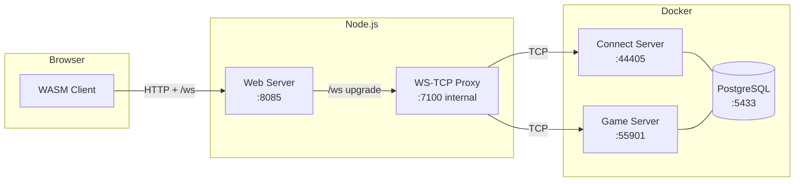

# OpenMU Browser Stack

MU Online in the browser. Server-side infrastructure to run MU Online via WebAssembly, using [OpenMU](https://github.com/MUnique/OpenMU) as the game server.

## What is this

Everything you need on the server side to bridge a WASM MU client to OpenMU:

- **Game Server** — OpenMU (C#/.NET) running via Docker with PostgreSQL
- **WebSocket-TCP Proxy** — Bridge between the browser (WebSocket only) and OpenMU (TCP)
- **Web Server** — Serves the WASM client with required headers (COOP/COEP)
- **HTML Template** — Ready to receive a compiled WASM client



**Connection flow:**
1. Client opens the WebSocket to `wss://<host>/ws` → the web server forwards the upgrade to the local proxy
2. Proxy connects TCP to the Connect Server (:44405)
3. Connect Server sends ConnectionInfo (`C1 F4 03`) with the Game Server IP:port
4. Proxy rewrites the IP:port to the public address, stores the real target
5. Client reconnects to `/ws` → proxy routes TCP to the Game Server (:55901)

## Status

| Component | Status |
|-----------|--------|
| WebSocket-TCP Proxy | Implemented, not tested end-to-end |
| Web Server (static + COOP/COEP) | Implemented |
| MU Packet Parser (C1/C2/C3/C4) | Implemented |
| ConnectionInfo Rewriter (F4 03) | Implemented |
| OpenMU via Docker | Configured |
| **WASM Client** | Built separately; place the output in `public/` (see [WASM Client](#wasm-client)) |

> **Note:** This repository does not ship the compiled WASM client. The proxy
> and packet parser are exercised by the client build placed in `public/`.

## Quick Start

### Prerequisites

- Docker and Docker Compose
- Node.js 22+ only if you want to run the Node stack outside Docker

### 1. Clone and configure

```bash
git clone https://github.com/your-username/openmu-browser-stack.git
cd openmu-browser-stack
cp .env.example .env
```

Put the compiled WASM client in `public/` (`Main.js`, `Main.wasm`, `Main.data`,
...). Those files are not stored in git; see [WASM Client](#wasm-client).

### 2. Start everything

```bash
docker compose up -d --build
```

This starts PostgreSQL, OpenMU and the Node stack (`stack` service). The web
client and the `/ws` WebSocket proxy share one port: 8085 inside the container,
published on `127.0.0.1:8085` on the host. That is the address nginx (or a local
browser) connects to.

Services:

- **Web client + `/ws` proxy:** http://localhost:8085
- **OpenMU admin panel:** http://localhost:8090
- **Connect Server:** port 44405
- **Game Servers:** ports 55901-55906
- **Chat Server:** port 55980

### 3. Open

Go to http://localhost:8085. You will see the client (or the placeholder page if
`public/` has no WASM build yet). See [WASM Client](#wasm-client) for the next
step.

### Running the Node stack outside Docker

For client development, or if you prefer Node on the host:

```bash
npm install
npm start
```

Or separately:

```bash
npm run proxy   # WebSocket proxy on port 7100
npm run serve   # Web server on port 8085
```

## HTTPS / playing from another device

The WASM client renders through WebGPU. Browsers only expose WebGPU in a
**secure context**, and they only treat `localhost` / `127.0.0.1` as secure.
Opening `http://192.168.x.x:8085` from another machine (for example Safari on
a Mac) leaves `navigator.gpu` undefined, so the client fails with
`Requesting WebGPU adapter failed!` / `SDL_gpu renderer init failed.`

Serve the stack over HTTPS and WSS instead:

1. Generate a certificate that includes the LAN IP of the server. With
   [mkcert](https://github.com/FiloSottile/mkcert):

   ```powershell
   # Windows (server)
   winget install FiloSottile.mkcert
   ./scripts/generate-certs.ps1 192.168.1.106
   ```

   If PowerShell blocks the script, run it with
   `powershell -ExecutionPolicy Bypass -File scripts/generate-certs.ps1 192.168.1.106`.

   Or run mkcert directly:

   ```powershell
   mkcert -install
   mkcert -cert-file certs/server.crt -key-file certs/server.key 192.168.1.106 localhost 127.0.0.1
   ```

2. Enable TLS in `.env`:

   ```
   TLS_CERT_PATH=certs/server.crt
   TLS_KEY_PATH=certs/server.key
   ```

3. Trust the mkcert root CA on the client machine (the Mac). Copy `rootCA.pem`
   from the folder printed by `mkcert -CAROOT`, open it in Keychain Access, add
   it to the *System* keychain and set it to *Always Trust*.

4. Restart the stack and open `https://192.168.1.106:8085`.

If the server's LAN IP changes (DHCP), regenerate the certificate with the new
address, otherwise the browser will reject the HTTPS/WSS connection.

Safari exposes WebGPU from Safari 26 (macOS 26) onwards. On Safari 17.4–18.x
enable it under *Develop → Feature Flags → WebGPU*. Even with the flag, an
`http://` LAN origin still leaves `navigator.gpu` undefined.

The web server and the WebSocket proxy switch together to HTTPS/WSS. The
client build hardcodes `ws://<host>:7100`, so `public/index.html` routes every
socket to the page's own origin at `/ws`; the web server forwards those upgrades
to the proxy on loopback (`127.0.0.1:7100`). This keeps a single public port and
means the proxy never has to be exposed. `PROXY_PUBLIC_HOST=auto` makes the
ConnectionInfo rewrite reuse the address the browser connected to instead of a
hardcoded localhost.

Without `TLS_CERT_PATH`/`TLS_KEY_PATH` the stack keeps using plain HTTP, which
is only usable from `http://localhost` (or Chrome on an origin explicitly
declared secure with `chrome://flags/#unsafely-treat-insecure-origin-as-secure`).

## Deploying behind nginx (domain + Let's Encrypt)

This is the recommended production setup. nginx terminates TLS, the Node stack
listens only on loopback, and the browser uses a single public origin for both
the client and the WebSocket (`https://mu.example.com/ws`).

### 1. DNS and firewall

- Point an `A`/`AAAA` record for `mu.example.com` at the server.
- Allow inbound TCP **80** and **443** only. Do not expose 8085 or 7100.

### 2. Run the stack on loopback

On the server, set `.env` to:

```env
WEB_HOST=127.0.0.1
WEB_PORT=8085
WS_HOST=127.0.0.1
WS_PORT=7100
MU_CONNECT_HOST=127.0.0.1
MU_CONNECT_PORT=44405
MU_GAME_HOST=127.0.0.1
PROXY_PUBLIC_HOST=auto
PROXY_PUBLIC_PORT=auto

# nginx terminates TLS: leave the Node TLS settings empty
# TLS_CERT_PATH=
# TLS_KEY_PATH=
```

Do **not** set `TLS_CERT_PATH`/`TLS_KEY_PATH` on this server. The Node web
server stays HTTP internally; nginx serves HTTPS and forwards plain HTTP/WS to
loopback, so the browser still gets a secure context and WSS.

Start the stack with `node start-services.js` (or as a service, below).

### 3. systemd unit (optional)

Example: [`deploy/mu-browser-stack.service.example`](deploy/mu-browser-stack.service.example).
Copy it to `/etc/systemd/system/mu-browser-stack.service`, adjust the paths and
user, then reload:

```ini
[Unit]
Description=OpenMU browser stack
After=network.target docker.service

[Service]
Type=simple
WorkingDirectory=/opt/openmu-browser-stack
ExecStart=/usr/bin/node start-services.js
Restart=on-failure
RestartSec=3
Environment=NODE_ENV=production

[Install]
WantedBy=multi-user.target
```

```bash
sudo systemctl daemon-reload
sudo systemctl enable --now mu-browser-stack
```

`start-services.js` starts both the web server and the WebSocket proxy in one
process and writes `proxy.log` next to it.

### 4. nginx + certbot

Full example: [`deploy/nginx.conf.example`](deploy/nginx.conf.example).

```bash
sudo apt update
sudo apt install nginx certbot python3-certbot-nginx
sudo mkdir -p /var/www/certbot
```

Create `/etc/nginx/sites-available/mu.example.com` with the HTTP-only vhost
first:

```nginx
server {
    listen 80;
    listen [::]:80;
    server_name mu.example.com;

    location /.well-known/acme-challenge/ {
        root /var/www/certbot;
    }

    location / {
        proxy_pass http://127.0.0.1:8085;
        proxy_http_version 1.1;
        proxy_set_header Host $http_host;
        proxy_set_header X-Real-IP $remote_addr;
        proxy_set_header X-Forwarded-For $proxy_add_x_forwarded_for;
        proxy_set_header X-Forwarded-Proto $scheme;
        proxy_set_header X-Forwarded-Host $host;
        proxy_set_header X-Forwarded-Port $server_port;
    }
}
```

Enable it, check it and obtain the certificate:

```bash
sudo ln -s /etc/nginx/sites-available/mu.example.com /etc/nginx/sites-enabled/
sudo nginx -t
sudo systemctl reload nginx
sudo certbot certonly --webroot -w /var/www/certbot -d mu.example.com
```

Now replace the vhost with the final HTTPS configuration:

```nginx
map $http_upgrade $connection_upgrade {
    default upgrade;
    ''      close;
}

server {
    listen 80;
    listen [::]:80;
    server_name mu.example.com;

    location /.well-known/acme-challenge/ {
        root /var/www/certbot;
    }

    location / {
        return 301 https://$host$request_uri;
    }
}

server {
    listen 443 ssl http2;
    listen [::]:443 ssl http2;
    server_name mu.example.com;

    ssl_certificate     /etc/letsencrypt/live/mu.example.com/fullchain.pem;
    ssl_certificate_key /etc/letsencrypt/live/mu.example.com/privkey.pem;
    include /etc/letsencrypt/options-ssl-nginx.conf;
    ssl_dhparam /etc/letsencrypt/ssl-dhparams.pem;

    location /ws {
        proxy_pass http://127.0.0.1:8085;
        proxy_http_version 1.1;
        proxy_set_header Upgrade $http_upgrade;
        proxy_set_header Connection $connection_upgrade;
        proxy_set_header Host $http_host;
        proxy_set_header X-Real-IP $remote_addr;
        proxy_set_header X-Forwarded-For $proxy_add_x_forwarded_for;
        proxy_set_header X-Forwarded-Proto $scheme;
        proxy_set_header X-Forwarded-Host $host;
        proxy_set_header X-Forwarded-Port $server_port;
        proxy_read_timeout 3600s;
        proxy_send_timeout 3600s;
    }

    location / {
        proxy_pass http://127.0.0.1:8085;
        proxy_http_version 1.1;
        proxy_set_header Host $http_host;
        proxy_set_header X-Real-IP $remote_addr;
        proxy_set_header X-Forwarded-For $proxy_add_x_forwarded_for;
        proxy_set_header X-Forwarded-Proto $scheme;
        proxy_set_header X-Forwarded-Host $host;
        proxy_set_header X-Forwarded-Port $server_port;
    }
}
```

```bash
sudo nginx -t
sudo systemctl reload nginx
sudo certbot renew --dry-run
```

Open `https://mu.example.com`.

Notes:

- `location /ws` can also proxy directly to `http://127.0.0.1:7100`. Proxying to
  8085 keeps a single upstream and lets the Node web server own the upgrade.
- `X-Forwarded-Host`/`X-Forwarded-Port` make `PROXY_PUBLIC_HOST=auto` write the
  public address into `ConnectionInfo`.
- The web server normalises `X-Real-IP`/`X-Forwarded-For` before forwarding the
  upgrade. Without that, every player behind nginx would look like `127.0.0.1`
  and their game-server redirects would collide.
- certbot installs a renewal timer; nginx reloads automatically when the
  `python3-certbot-nginx` plugin is used. With `certonly --webroot`, add
  `--deploy-hook "systemctl reload nginx"` or a cron entry if needed.
- Behind Cloudflare or another CDN, enable WebSocket support and use
  **Full (strict)** TLS with a valid origin certificate.
- If you serve `public/` directly from nginx instead of proxying to the Node
  web server, add `add_header Cross-Origin-Opener-Policy same-origin;` and
  `add_header Cross-Origin-Embedder-Policy require-corp;` and proxy `/ws`
  directly to `http://127.0.0.1:7100`.

## Docker deployment details

The compose file builds the Node stack from the local `Dockerfile` and runs it
as the `stack` service.

### Layout

- `Dockerfile`: Node 22 Alpine, production dependencies only, non-root `node`
  user, healthcheck on `/healthz`.
- `.dockerignore`: keeps `.env`, `certs/`, `node_modules`, tests and logs out of
  the image.
- `docker-compose.yml`: adds `stack` next to `postgres` and `openmu`.

### Networking

- `stack` reaches the connect server at `openmu:44405` and the game servers at
  `openmu:<port>` through the compose network.
- Port 8085 is published on `127.0.0.1` only, so nginx on the host can proxy to
  it and the LAN cannot bypass nginx.
- Port 7100 is internal. The browser uses `/ws` on 8085, and the web server
  forwards the upgrade to the proxy inside the same container.
- Publishing a port hides the original client IP behind Docker's bridge. The
  compose service sets `TRUSTED_PROXY_IPS` to loopback plus `172.16.0.0/12` so
  nginx's `X-Forwarded-For` is honoured. If you publish 8085 directly to the
  LAN, set it to your reverse proxy only (or keep the default loopback scope).

To access the container directly from the LAN (without nginx), change the port
mapping in `docker-compose.yml` to:

```yaml
ports:
  - "${WEB_PORT:-8085}:${WEB_PORT:-8085}"
```

Then open `http://<host>:8085`. WebGPU still requires HTTPS or localhost, so
for LAN play you also need in-container TLS (below) or nginx.

### TLS

Recommended: nginx on the host terminates TLS. The container stays HTTP and
compose publishes 8085 on loopback; the nginx section above works unchanged.

To serve HTTPS directly from the container with mkcert:

1. Mount the certificate directory by uncommenting the `volumes` block in
   `docker-compose.yml`:

   ```yaml
   volumes:
     - ./certs:/app/certs:ro
   ```

2. Set in `.env`:

   ```env
   DOCKER_TLS_CERT_PATH=/app/certs/server.crt
   DOCKER_TLS_KEY_PATH=/app/certs/server.key
   ```

3. Publish the port on all interfaces (or the LAN IP) instead of loopback:

   ```yaml
   ports:
     - "${WEB_PORT:-8085}:${WEB_PORT:-8085}"
   ```

If nginx is also a container in the same compose network, proxy to
`http://stack:8085` instead of `127.0.0.1:8085`.

### Updating and logs

`public/Main.*` is baked into the image. After replacing the client build:

```bash
docker compose build stack
docker compose up -d stack
```

Logs and health:

```bash
docker compose logs -f stack
docker compose ps
```

The stack also writes `proxy.log` inside the container; Docker's log driver is
usually enough.

## Temporary access with Cloudflare Tunnel

With the Docker stack running, expose it temporarily with a quick tunnel:

```bash
cloudflared tunnel --url http://localhost:8085
```

Cloudflare prints an ephemeral `https://<something>.trycloudflare.com` URL. The
browser gets a secure context (so WebGPU works) and the client uses
`wss://<tunnel-host>/ws` automatically; no `.env` change is needed.

Notes:

- The quick-tunnel hostname changes every time cloudflared restarts.
- The proxy writes the tunnel hostname into the 16-byte `ConnectionInfo` address
  field. If the hostname does not fit, it writes `127.0.0.1` and the client shim
  still routes to the page origin. This avoids the `Invalid url for WebSocket`
  error caused by a truncated hostname.
- The proxy sends WebSocket pings every 30 seconds, below Cloudflare's ~100 s
  idle timeout.
- Cloudflare's `CF-Connecting-IP` / `X-Forwarded-For` are used for the real
  client IP, so sessions do not collide behind the tunnel.
- For a named tunnel with your own domain, use `cloudflared tunnel create`,
  `cloudflared tunnel route dns` and a local `config.yml` pointing at
  `http://localhost:8085`. If Cloudflare's proxy is enabled for that domain,
  disable Rocket Loader, which can break the WASM bootstrap.


## WASM Client

This repository **does not include** the game client. You need to compile a MU Online client to WebAssembly.

### Recommended client: MuMain

[sven-n/MuMain](https://github.com/sven-n/MuMain) is the best candidate:

- **C++ with OpenGL** — Emscripten maps OpenGL ES to WebGL natively
- Compatible with OpenMU (standard MU protocol C1/C2/C3/C4)

### Required work

| Task | Description |
|------|-------------|
| OpenGL 1.x → OpenGL ES 2.0 | Replace `glBegin`/`glEnd` with VBOs + GLSL ES shaders |
| Networking .NET → C++ | Rewrite `ClientLibrary` (.NET AOT) in pure C++ |
| Win32 → SDL2/Emscripten | Replace `windows.h` with SDL2 (cross-platform) |
| Audio → Web Audio | Replace DirectSound/wzAudio with OpenAL or SDL_mixer |
| Game loop | Adapt to `emscripten_set_main_loop()` |
| Assets | Package BMD/OZJ/OZB into Emscripten's `.data` file |

### Integrating the compiled client

1. Compile with Emscripten (outputs `.js`, `.wasm`, `.data`)
2. Copy to `public/`
3. Add `<script async src="YourClient.js"></script>` to `public/index.html`
4. `Module.websocket.url` already points to the proxy (`ws://127.0.0.1:7100`)

### Browser caching of the client files

The web server sends `Cache-Control: no-cache`, a strong `ETag` (file size +
modification time) and `Last-Modified` for every file in `public/`, and answers
conditional requests with `304 Not Modified` and no body. The browser keeps a
copy but checks it before each use: an unchanged file costs a 304, while a
rebuilt file has a new mtime and is downloaded again on the next load.
COOP/COEP headers are sent on `200` and `304` alike.

```bash
npm test
```

```bash
curl -sI http://localhost:8085/Main.wasm
```

Browsers do not store very large single responses in their HTTP cache
(Firefox's default per-entry limit is 50 MB; Chromium allows one eighth of the
cache size). The ~775 MB `Main.data` will usually be fetched again even though
the server supports revalidation; `Main.wasm`, `Main.js` and `index.html` are
cached. Splitting the data package into smaller files is tracked separately.

Possible follow-up for production: content-hashed file names for build outputs
would allow `Cache-Control: immutable` with no revalidation at all.

## MU Online Protocol

The proxy understands MU packet framing:

| Header | Size | Encryption |
|--------|------|------------|
| `C1` | 1 byte (max 255) | None |
| `C2` | 2 bytes BE (max 65535) | None |
| `C3` | 1 byte | SimpleModulus / XOR32 |
| `C4` | 2 bytes BE | SimpleModulus / XOR32 |

The proxy is transparent to encryption. The only exception is the **ConnectionInfo** packet (`C1 F4 03`), whose IP:port is rewritten to redirect connections through the proxy.

## Structure

```
openmu-browser-stack/
├── docker-compose.yml          # OpenMU + PostgreSQL
├── .env.example                # Configuration template
├── package.json
├── public/
│   └── index.html              # HTML template for the WASM client
└── src/
    ├── proxy/
    │   ├── index.js            # Proxy entry point
    │   ├── ws-server.js        # WebSocket↔TCP bridge
    │   ├── tcp-client.js       # TCP client wrapper
    │   ├── packet-parser.js    # MU packet framing (C1/C2/C3/C4)
    │   └── packet-rewriter.js  # ConnectionInfo (F4 03) rewriter
    └── web/
        └── server.js           # Static file server
```

## Configuration

Copy `.env.example` to `.env`:

| Variable | Default | Description |
|----------|---------|-------------|
| `WS_PORT` | 7100 | WebSocket proxy port |
| `WS_HOST` | 127.0.0.1 | Proxy bind address (internal; keep loopback) |
| `WEB_PORT` | 8085 | Web server port |
| `WEB_HOST` | 0.0.0.0 | Web server bind address |
| `MU_CONNECT_HOST` | 127.0.0.1 | Connect Server host |
| `MU_CONNECT_PORT` | 44405 | Connect Server port |
| `MU_GAME_HOST` | 127.0.0.1 | Game Server host (for IP remapping) |
| `PROXY_PUBLIC_HOST` | auto | Host written into ConnectionInfo (`auto` = host the browser used) |
| `PROXY_PUBLIC_PORT` | auto | Port written into ConnectionInfo (`auto` = port the browser used) |
| `WS_FORWARD_HOST` | 127.0.0.1 | Proxy host the web server forwards `/ws` to |
| `WS_FORWARD_PORT` | `WS_PORT` | Proxy port the web server forwards `/ws` to |
| `TRUSTED_PROXY_IPS` | 127.0.0.1,::1 | Proxy IPs/CIDRs allowed to set `X-Forwarded-*` |
| `TLS_CERT_PATH` | (empty) | TLS certificate path; enables HTTPS/WSS when set |
| `TLS_KEY_PATH` | (empty) | TLS private key path; enables HTTPS/WSS when set |

## Troubleshooting

**Port 7100 in use (macOS):** Disable AirPlay Receiver in System Settings → General → AirDrop & Handoff, or change `WS_PORT`.

**Safari says `navigator.gpu is not available`:** Open the browser console and
check `window.isSecureContext` and `navigator.gpu`. On a LAN address both are
only available over HTTPS. Follow the **HTTPS / playing from another device**
section above, trust the mkcert root CA on the Mac, and make sure Safari 26+ is
in use (or the WebGPU feature flag is on). Also allow ports 8085 and 7100
through the Windows firewall and the macOS local-network permission.

**`Invalid url for WebSocket ws://...:7100` behind a Cloudflare tunnel:** the
`ConnectionInfo` address field is only 16 bytes, so a long
`*.trycloudflare.com` hostname used to be truncated. The proxy now writes a
safe `127.0.0.1` placeholder and the client shim connects to
`wss://<page-origin>/ws`. If it persists, hard-refresh so the browser drops a
cached `index.html`/`Main.js`.

**`No available adapters` / `requestAdapter returned null`:** Chrome or Edge
could not create a WebGPU adapter. Integrated graphics are supported; a
dedicated GPU is not required. Open `chrome://gpu` and check that WebGPU is
hardware accelerated, enable *Use graphics acceleration when available* in the
browser settings, update the GPU driver from Intel/AMD/NVIDIA, and restart the
browser. If WebGPU is blocklisted, try `chrome://flags/#ignore-gpu-blocklist`
and `chrome://flags/#enable-unsafe-webgpu`. The
`powerPreference option is currently ignored` warning on Windows is harmless:
Chrome always uses the laptop's integrated GPU.

This client is WebGPU-only and has no WebGL fallback, so hardware that cannot
create a WebGPU adapter cannot run it. The loader now checks for a WebGPU
adapter before downloading `Main.data`, and shows these steps instead of a
console-only failure.

**OpenMU won't start:** `docker compose down -v && docker compose up -d` to clean up and restart.

**Inventory crashes with `RuntimeError: index out of bounds`:** The client is
being resolved as the Season 6 GMO client, so OpenMU sends the legacy 12-byte
item format while the WASM client only parses the extended format. OpenMU's
seed writes `20404` into both the GMO and the Season 106 client definitions;
the GMO row is registered last and wins. Run the fix and restart OpenMU:

```bash
# Bash
docker exec -i openmu-browser-stack-postgres-1 psql -U openmu -d openmu < scripts/fix-client-version.sql
docker restart openmu-browser-stack-openmu-1
```

```powershell
# PowerShell
Get-Content scripts/fix-client-version.sql -Raw | docker exec -i openmu-browser-stack-postgres-1 psql -U openmu -d openmu -f -
docker restart openmu-browser-stack-openmu-1
```

The login log should then say `version:Season 106 Episode 3 English` instead of
`version:Season 6 Episode 3 English`. Re-run the script after
`docker compose down -v`, since a fresh volume is re-seeded with the bad value.

## License

MIT
